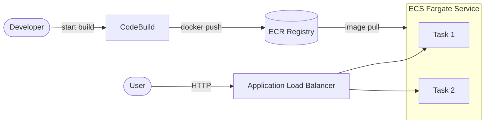

# AWS ECS Fargate + ECR + CodeBuild (Terraform)

> Containerized app on **ECS Fargate** behind an ALB, with an **ECR** registry and a **CodeBuild** CI job that builds and pushes the image — all in Terraform.
> **Author:** Muhammad Ahmad · **IaC:** Terraform · **Cloud:** AWS


---

## 📌 Overview

- **ECR** private registry (scan-on-push) holds the application image.
- **CodeBuild** builds a Docker image and pushes it to ECR (see `buildspec.yml`).
- **ECS Fargate** runs the container as a serverless task — no EC2 to manage.
- **Application Load Balancer** fronts the service; **target-tracking autoscaling** keeps 2–4 tasks on CPU load.
- **CloudWatch Logs** collects container logs.

## 🏗️ Architecture



## 🚀 Deploy

```bash
cd terraform
terraform init
terraform apply
```

Build & push a fresh image, then force a new deployment:

```bash
aws codebuild start-build --project-name $(terraform output -raw codebuild_project)
aws ecs update-service --cluster $(terraform output -raw ecs_cluster) \
  --service ahmad-fargate-service --force-new-deployment
terraform output application_url
```

## 🧹 Clean up

```bash
terraform destroy
```

## 💰 Cost note

Fargate tasks, the ALB, and CodeBuild minutes bill while running. Destroy when finished.

## 🔐 Production hardening (next steps)

- Point CodeBuild at your **GitHub repo** via a CodeStar connection, and wrap it in **CodePipeline** (Source → Build → Deploy).
- Move tasks to **private subnets** + NAT and tighten egress.
- Add **blue/green** deployments with CodeDeploy.

---

*Built and maintained by **Muhammad Ahmad**.*
