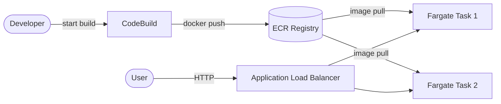

# Architecture Diagram — AWS ECS Fargate + ECR + CodeBuild

## Lucid diagram

- **View:** https://lucid.app/lucidchart/bc509269-b20e-4124-ad3c-7371b5971c59/view
- **Edit:** https://lucid.app/lucidchart/bc509269-b20e-4124-ad3c-7371b5971c59/edit

## Lucid prompt (reusable)

```
Create an AWS architecture diagram titled "AWS ECS Fargate CI/CD".
A Developer starts a CodeBuild job; CodeBuild does a docker push to an ECR registry;
ECS Fargate pulls the image from ECR and runs two tasks; an Application Load Balancer
sends user HTTP traffic to the Fargate tasks. Label arrows (start build, docker push,
image pull, HTTP). Clean, professional AWS colors.
```

## Mermaid source


